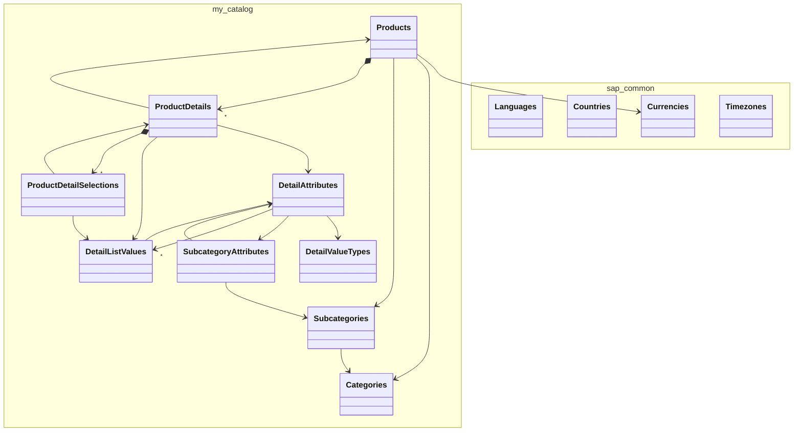

<!-- generated by scripts/gen-registry.mjs | sources: a9b90807f6611663 | 2026-10-12 | do not edit -->
# Domain model

Effective model after compilation: entities, elements, types and aspects of the project. The source of truth is `db/*.cds` and `srv/annotations/*.cds`; this is only their reflection. For a targeted lookup use `mcp__cds-mcp__search_model`.

## Diagram

## Entities

### my.catalog.Products

Aspects: cuid, managed. Keys: ID. Projections: CatalogService.Products.

| Element | Type | Title (en) | Annotations |
| --- | --- | --- | --- |
| ID | UUID(36) |  | key |
| createdAt | Timestamp | Created On | @readonly, computed |
| createdBy | String(255) | Created By | @readonly, computed |
| modifiedAt | Timestamp | Changed On | @readonly, computed |
| modifiedBy | String(255) | Changed By | @readonly, computed |
| name | String(100) | Product Name | @mandatory |
| description | String(500) | Description |  |
| price | Decimal(15, 2) | Price | @mandatory, @Measures.ISOCurrency: currency_code, @assert.range: [0,99999999.99] |
| currency | Association to sap.common.Currencies | Currency | @mandatory, @assert.target: true |
| currency_code | String(3) | Currency | @mandatory, @assert.target: true |
| stock | Integer | Stock Quantity | @mandatory, @assert.range: [0,1000000] |
| rating | Integer | Rating | @assert.range: [0,5] |
| category | Association to my.catalog.Categories | Category | @mandatory, @assert.target: true |
| category_code | String(20) | Category | @mandatory, @assert.target: true |
| subcategory | Association to my.catalog.Subcategories | Subcategory | @mandatory, @assert.target: true |
| subcategory_code | String(20) | Subcategory | @mandatory, @assert.target: true |
| imageUrl | String(500) | Image URL |  |
| details | Composition of many my.catalog.ProductDetails | Details |  |

### my.catalog.Categories

Aspects: sap.common.CodeList. Keys: code. Projections: CatalogService.Categories.

| Element | Type | Title (en) | Annotations |
| --- | --- | --- | --- |
| name | String(255) | Name |  |
| descr | String(1000) | Description |  |
| code | String(20) | Category | key |
| texts | Composition of many my.catalog.Categories.texts |  |  |
| localized | Association to my.catalog.Categories.texts |  |  |

### my.catalog.Categories.texts

Aspects: sap.common.TextsAspect. Keys: locale, code. Projections: CatalogService.Categories.texts.

| Element | Type | Title (en) | Annotations |
| --- | --- | --- | --- |
| locale | String(14) | Language Code | key |
| name | String(255) | Name |  |
| descr | String(1000) | Description |  |
| code | String(20) |  | key |

### my.catalog.Subcategories

Aspects: sap.common.CodeList. Keys: code. Projections: CatalogService.Subcategories.

| Element | Type | Title (en) | Annotations |
| --- | --- | --- | --- |
| name | String(255) | Name |  |
| descr | String(1000) | Description |  |
| code | String(20) | Subcategory | key |
| category | Association to my.catalog.Categories | Category |  |
| category_code | String(20) | Category |  |
| texts | Composition of many my.catalog.Subcategories.texts |  |  |
| localized | Association to my.catalog.Subcategories.texts |  |  |

### my.catalog.Subcategories.texts

Aspects: sap.common.TextsAspect. Keys: locale, code. Projections: CatalogService.Subcategories.texts.

| Element | Type | Title (en) | Annotations |
| --- | --- | --- | --- |
| locale | String(14) | Language Code | key |
| name | String(255) | Name |  |
| descr | String(1000) | Description |  |
| code | String(20) |  | key |

### my.catalog.ProductDetails

Aspects: cuid. Keys: ID. Projections: CatalogService.ProductDetails.

| Element | Type | Title (en) | Annotations |
| --- | --- | --- | --- |
| ID | UUID(36) |  | key |
| product | Association to my.catalog.Products | Product |  |
| product_ID | UUID(36) | Product |  |
| attribute | Association to my.catalog.DetailAttributes | Attribute | @mandatory, @assert.target: true |
| attribute_code | String(30) | Attribute | @mandatory, @assert.target: true |
| position | Integer | Position | @readonly, computed |
| textValue | String(100) | Text Value |  |
| numberValue | Decimal(15, 3) | Number Value |  |
| listValue | Association to my.catalog.DetailListValues | List Value | @assert.target: true |
| listValue_code | String(30) | List Value | @assert.target: true |
| selections | Composition of many my.catalog.ProductDetailSelections |  |  |

### my.catalog.DetailAttributes

Aspects: sap.common.CodeList. Keys: code. Projections: CatalogService.DetailAttributes.

| Element | Type | Title (en) | Annotations |
| --- | --- | --- | --- |
| name | String(255) | Name |  |
| descr | String(1000) | Description |  |
| code | String(30) | Attribute | key |
| unit | String(10) | Unit |  |
| valueType | Association to my.catalog.DetailValueTypes | Value Type |  |
| valueType_code | String(20) | Value Type |  |
| minValue | Decimal(15, 3) | Minimum Value |  |
| maxValue | Decimal(15, 3) | Maximum Value |  |
| scale | Integer | Decimal Places |  |
| subcategories | Association to many my.catalog.SubcategoryAttributes |  |  |
| values | Association to many my.catalog.DetailListValues |  |  |
| texts | Composition of many my.catalog.DetailAttributes.texts |  |  |
| localized | Association to my.catalog.DetailAttributes.texts |  |  |

### my.catalog.DetailValueTypes

Aspects: sap.common.CodeList. Keys: code. Projections: CatalogService.DetailValueTypes.

| Element | Type | Title (en) | Annotations |
| --- | --- | --- | --- |
| name | String(255) | Name |  |
| descr | String(1000) | Description |  |
| code | String(20) | Value Type | key |
| texts | Composition of many my.catalog.DetailValueTypes.texts |  |  |
| localized | Association to my.catalog.DetailValueTypes.texts |  |  |

### my.catalog.DetailValueTypes.texts

Aspects: sap.common.TextsAspect. Keys: locale, code. Projections: CatalogService.DetailValueTypes.texts.

| Element | Type | Title (en) | Annotations |
| --- | --- | --- | --- |
| locale | String(14) | Language Code | key |
| name | String(255) | Name |  |
| descr | String(1000) | Description |  |
| code | String(20) |  | key |

### my.catalog.SubcategoryAttributes

Aspects: cuid. Keys: ID. Projections: CatalogService.SubcategoryAttributes.

| Element | Type | Title (en) | Annotations |
| --- | --- | --- | --- |
| ID | UUID(36) |  | key |
| subcategory | Association to my.catalog.Subcategories | Subcategory |  |
| subcategory_code | String(20) | Subcategory |  |
| attribute | Association to my.catalog.DetailAttributes | Attribute |  |
| attribute_code | String(30) | Attribute |  |
| position | Integer | Position |  |

### my.catalog.DetailListValues

Aspects: sap.common.CodeList. Keys: code. Projections: CatalogService.DetailListValues.

| Element | Type | Title (en) | Annotations |
| --- | --- | --- | --- |
| name | String(255) | Name |  |
| descr | String(1000) | Description |  |
| code | String(30) | List Value | key |
| attribute | Association to my.catalog.DetailAttributes | Attribute |  |
| attribute_code | String(30) | Attribute |  |
| position | Integer | Position |  |
| texts | Composition of many my.catalog.DetailListValues.texts |  |  |
| localized | Association to my.catalog.DetailListValues.texts |  |  |

### my.catalog.DetailListValues.texts

Aspects: sap.common.TextsAspect. Keys: locale, code. Projections: CatalogService.DetailListValues.texts.

| Element | Type | Title (en) | Annotations |
| --- | --- | --- | --- |
| locale | String(14) | Language Code | key |
| name | String(255) | Name |  |
| descr | String(1000) | Description |  |
| code | String(30) |  | key |

### my.catalog.DetailAttributes.texts

Aspects: sap.common.TextsAspect. Keys: locale, code. Projections: CatalogService.DetailAttributes.texts.

| Element | Type | Title (en) | Annotations |
| --- | --- | --- | --- |
| locale | String(14) | Language Code | key |
| name | String(255) | Name |  |
| descr | String(1000) | Description |  |
| code | String(30) |  | key |

### my.catalog.ProductDetailSelections

Aspects: cuid. Keys: ID. Projections: CatalogService.ProductDetailSelections.

| Element | Type | Title (en) | Annotations |
| --- | --- | --- | --- |
| ID | UUID(36) |  | key |
| detail | Association to my.catalog.ProductDetails | Detail |  |
| detail_ID | UUID(36) | Detail |  |
| value | Association to my.catalog.DetailListValues | Value | @mandatory, @assert.target: true |
| value_code | String(30) | Value | @mandatory, @assert.target: true |

## Project types and aspects

| Name | Kind | Definition |
| --- | --- | --- |
| User | type | String(255) |
| Currency | type | Association to sap.common.Currencies |
| cuid | aspect | ID |
| managed | aspect | createdAt, createdBy, modifiedAt, modifiedBy |

## Reusable aspects from @sap/cds/common

`cuid` (key ID : UUID), `managed` (createdAt, createdBy, modifiedAt, modifiedBy), `temporal`, `Currency`, `Country`, `Language`, `sap.common.CodeList`. Use them, not your own copies.
